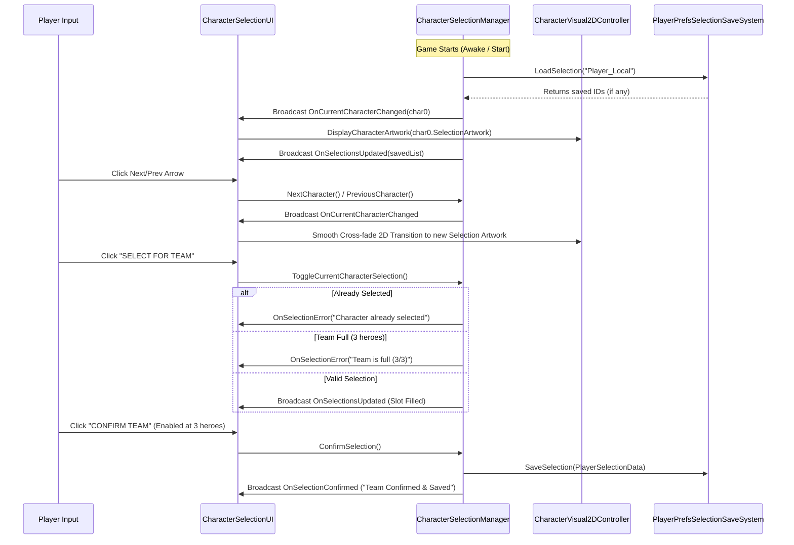

# CLASHURA — 2D System & Integration Guide

### 1. 2D Character Selection Sequence

---

### 2. Multi-Resolution Compatibility Matrix

| Screen Resolution | Aspect Ratio | Device Category | Scaling Behavior |
| :--- | :--- | :--- | :--- |
| **720 × 1280** | 9:16 (0.56) | Mobile Portrait (Compact) | PortraitMobile (Match Width 0.0) |
| **1080 × 1920** | 9:16 (0.56) | Mobile Portrait (FHD) | PortraitMobile (Match Width 0.0) |
| **1920 × 1080** | 16:9 (1.78) | Desktop Standard / Landscape Mobile | DesktopStandard (Match Height 1.0) |
| **2560 × 1440** | 16:9 (1.78) | Desktop 2K QHD | DesktopStandard (Match Height 1.0) |
| **3440 × 1440** | 21:9 (2.39) | Desktop Ultrawide Curved | UltrawideDesktop (Safe area anchored) |

---

### 3. Replacing Placeholder Art with Final Artwork

When final art assets are delivered:
1. **Portraits**: Place 128×128 (or higher) PNGs in `Assets/Clashura/Art/Characters/Portraits/`.
2. **Selection Artwork**: Place large illustrations in `Assets/Clashura/Art/Characters/SelectionArtwork/`.
3. **Gameplay Sprites**: Place 2D character sprites in `Assets/Clashura/Art/Characters/Sprites/`.
4. **Sprite Sheets**: Place 2D animation sheets in `Assets/Clashura/Art/Characters/SpriteSheets/`.
5. Open the respective `CharacterDataSO` asset in `Assets/Clashura/Data/Characters/ScriptableObjects/` and assign the imported sprite references.
6. Zero C# script changes are required when upgrading artwork.
